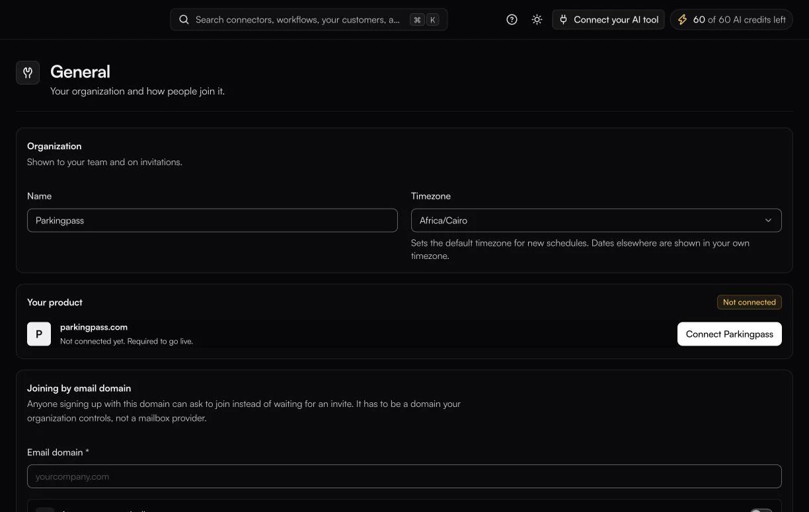

# General

**Settings → General**

### Organization

| Field        | Notes                                                                                              |
| ------------ | ---------------------------------------------------------------------------------------------------- |
| **Name**     | Shown to your team and on invitations.                                                              |
| **Timezone** | Sets the default timezone for new schedules. Dates elsewhere are shown in your own timezone.        |

<figure><figcaption>Your organization, your product and who can join.</figcaption></figure>


The timezone here is the default offered when creating a [schedule trigger](../build/triggers/README.md), not a global rewrite. A schedule keeps whatever timezone it was saved with.


### Your product

If you have started connecting your own product, a **Your product** card shows it, badged **Connected** or **Not connected**. Once connected it reads *{product} is connected to fastn.* Until then it reads *Not connected yet. Required to go live.* (or *API docs found, not connected yet. Required to go live.* once fastn has found your API docs) and offers **Connect {product}**. See [Connect your product](saas-connectors.md).

### Joining by email domain

Shown to Owners and Admins only. Anyone signing up with this domain can ask to join instead of waiting for an invite.

| Field                                  | Notes                                                                                                              |
| -------------------------------------- | -------------------------------------------------------------------------------------------------------------------- |
| **Email domain \***                    | Required. Placeholder `yourcompany.com`. Must be a domain your organization controls, not a mailbox provider.        |
| **Approve automatically**              | Off means an admin approves each request. Leave it off unless the domain is yours alone.                            |
| **Role people joining on this domain get** | One of **Viewer**, **Developer**, **Operator** or **End User**. It applies to people who join through this domain and preselects the role when you invite someone on it. It is a starting point, not a limit: you can still invite them as anything you are allowed to assign. |


Never set a mailbox provider here. Auto-approve on a shared domain means anyone with an address there can join your organization.


### Deleting an organization

This card explains where deletion lives, because it is not on this page:

* To delete **a customer**, open it under [Customers](../operate/customers.md), suspend it, then delete it there. Deleting a customer removes its connections, workflows and stored credentials, and cannot be undone.
* To delete **this organization**, contact fastn support. An organization has to be suspended before it can be deleted, and only fastn can suspend a top-level organization, so there is no self-serve path.

### Saving

Edits are not applied as you type. **Save changes** commits them and **Discard** throws them away; both are disabled until something has changed.
