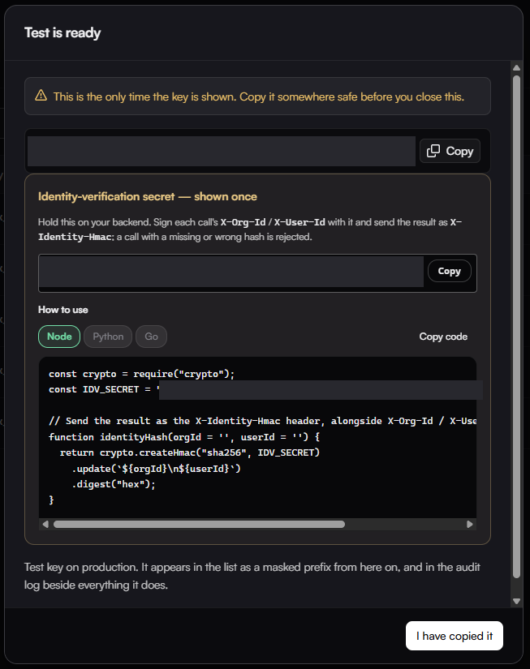

# Verify caller identity

By the end of this page, every call your backend makes with an API key proves which customer (`x-org-id`) and end user (`x-user-id`) it acts for, with a signed `x-identity-hmac` header.

Without identity verification, a key trusts the `x-org-id` and `x-user-id` headers it is sent. With it, the gateway recomputes the hash from those headers and checks it against the one you send, so only a backend that holds the secret can name a customer.

### Before you start

* You need access to **Embed → API keys and MCP** (owner, admin or developer).
* The key must reach more than one customer. Identity verification is not offered on a key pinned to exactly one customer, because that key already is the customer.
* You need a backend that can hold a secret. The secret never goes to a browser.

### 1. Turn on identity verification

On a new key, tick **Verify caller identity (HMAC)** in the **Create an API key** dialog (see [Create a key](api-keys.md#creating-a-key)). On an existing key, open the key's **…** menu and choose **Identity verification**.

Pick a mode:

| Mode | What happens to a call whose hash is missing or does not match |
| --- | --- |
| **Enforce** | Rejected with `401`. This is the mode the checkbox selects when you tick it. |
| **Monitor only** | Logged, and let through. Use it while your backend rolls out signing, then switch to **Enforce**. |
| **Off** | Not checked. The key trusts the headers. Turning verification off deletes the stored secret. |

**You should see:** after you create the key, a dialog shows the key and the identity-verification secret, with code snippets that compute the identity hash.

<figure><figcaption>The dialog shown after you create a key with identity verification on. The key and the secret are blanked out here.</figcaption></figure>


The secret is shown once and cannot be shown again. Keep it on your backend only: anyone who has it can compute a valid hash for any customer or user.


If you lose the secret, open **Identity verification** on the key's **…** menu and tick **Rotate the secret**. The new secret is also shown once, and the previous one keeps validating until the next rotation, so you can roll the new one out without downtime.

### 2. Compute the hash

The hash is an HMAC-SHA256 of the org id and the user id, joined by a newline, signed with your secret and written as hex. Use the values exactly as you send them in the headers; an absent header counts as an empty string.

```js
const crypto = require("crypto");
const IDV_SECRET = process.env.IDV_SECRET;

function identityHash(orgId = "", userId = "") {
  return crypto.createHmac("sha256", IDV_SECRET)
    .update(`${orgId}\n${userId}`)
    .digest("hex");
}
```

**You should see:** a 64-character hex string.

### 3. Send it with the identity headers

Send the hash as `x-identity-hmac`, together with the plaintext `x-org-id` and `x-user-id`:

```bash
curl -X POST https://api.fastn.dev/v1/workflows/WORKFLOW_ID/execute \
  -H "Authorization: Bearer fsk_live_<your-key>" \
  -H "x-org-id: <org-id>" \
  -H "x-user-id: <user-id>" \
  -H "x-identity-hmac: <identityHash(orgId, userId)>" \
  -H "Content-Type: application/json" \
  -d '{ "input": {} }'
```

The plaintext headers say which identity you claim; the hash proves your backend authorized that exact claim.

**You should see:** the call succeeds. With **Enforce**, a call with a wrong or missing hash is answered `401`; with **Monitor only**, it succeeds and the mismatch is logged.

The same headers work on a [webhook trigger](../operate/triggers/using-a-webhook-trigger.md) whose auth is API key.

### What's next

* [API keys](api-keys.md): create, rotate and revoke keys.
* [HTTP API](../reference/api.md): headers, environments and endpoints.
* [Security](../reference/security.md): how fastn protects credentials and callers.
