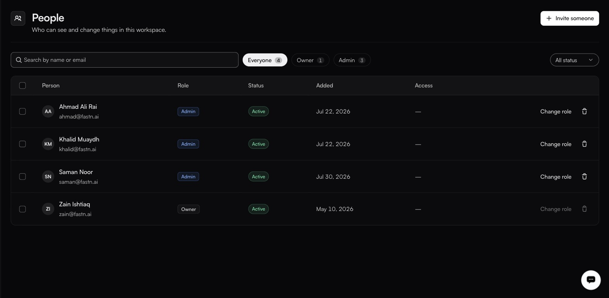

# People

**Settings → People**

<figure><figcaption>Change role is greyed out on every Owner row and on your own.</figcaption></figure>

| Column     | Notes                                                            |
| ---------- | ------------------------------------------------------------------ |
| **Person** | Name and email.                                                  |
| **Role**   | Their assigned role. **Change role** edits it.                   |
| **Status** | See [Statuses](#statuses) below.                                 |
| **Added**  | When they joined.                                                |
| **Access** | Time-limited access, if any: **Until** a date, **_N_d left** in the last week, or **Expired** once it has passed. A dash means access does not expire. |

**Search by name or email** narrows the list. Filter chips carry a count per role (Everyone, Owner, Admin and so on) and the dropdown on the right filters by status.

Each row carries a checkbox. Selecting rows opens a bar with **Change role…** (apply one role to everyone selected), **Deactivate** and **Clear**.

### Inviting someone

**Invite someone** sends an invitation to an email address with a role attached. Until they accept, they appear with status **Invited**, and their row carries **Resend invite** in case the email never arrived.

If you have set up [domain joining](general.md), people on that domain can request access instead of waiting for an invite, and the role you configured there is preselected when you invite them.

### Changing a role

**Change role** on any row. What you may assign is bounded by your own role. You cannot grant more than you hold.

**Change role** is disabled in two places:

* **Every Owner row.** An owner's role changes through **Transfer Ownership**, not here. The current Owner finds it in an Admin's panel; the Admin becomes the owner and you become an admin.
* **Your own row.** Another owner or admin has to change your role.

### Removing someone

The trash icon removes a person from the organization. You cannot remove yourself, and you cannot remove the organization's only owner (transfer ownership first). Their audit-log history stays, so *who did what* remains answerable after they leave.


API keys are organization credentials rather than personal ones, so do not assume that removing a person revokes the keys they created. Confirm on [API keys](api-keys.md) and rotate anything they had access to.


### Statuses

The status filter offers **All status** plus:

| Status            | Meaning                                       |
| ----------------- | ----------------------------------------------- |
| **Active**        | Signed up and usable.                          |
| **Invited**       | Invitation sent, not yet accepted. **Resend invite** sends the link again. |
| **Disabled**      | Deactivated. The person's panel offers **Reactivate**. |
| **Suspended**     | Deactivated. The person's panel offers **Reactivate**. |
| **Can't sign in** | The membership points at a sign-in identity that no longer exists, so the person is locked out until you remove them and invite them again. |

What each role can actually do is on the next page.

[Roles](roles.md)
