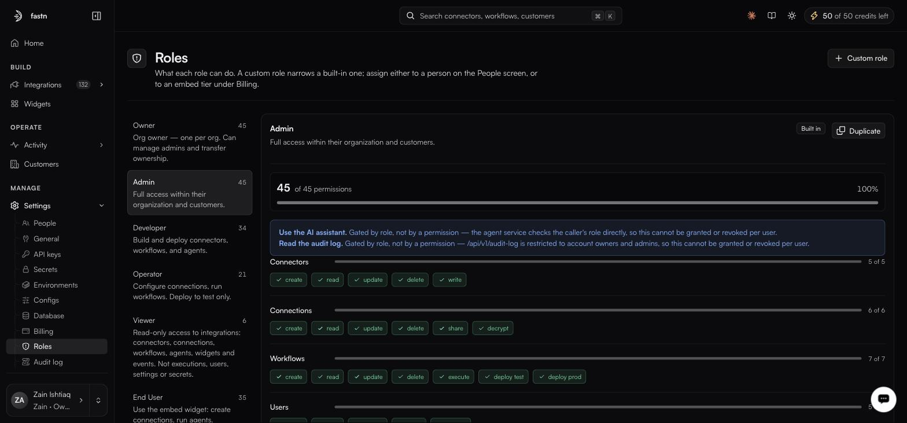

# Roles

**Settings → Roles**

<figure><figcaption>Some capabilities are called out as role-gated rather than grantable, such as using the AI assistant and reading the audit log.</figcaption></figure>

> What each role can do. A custom role narrows a built-in one; assign either to a person on the People screen, or to a customer tier under Billing.

### The six built-in roles

| Role          | Permissions | Summary                                                                                                                 |
| ------------- | ----------- | ------------------------------------------------------------------------------------------------------------------------- |
| **Owner**     | 44          | Can manage admins and transfer ownership.                                                                                |
| **Admin**     | 44          | Full access within their organization and customers.                                                                     |
| **Developer** | 36          | Builds and deploys connectors, workflows and agents.                                                                     |
| **Operator**  | 21          | Configures connections and runs workflows. Deploys to test only.                                                         |
| **Viewer**    | 6           | Read-only on connectors, connections, workflows, agents, widgets and events. Not executions, users, settings or secrets. |
| **End User**  | 35          | Uses the embed widget: creates connections, runs agents.                                                                 |

Selecting a role on the left shows its permission matrix, the count it holds out of 44, and a percentage bar. Built-in roles carry a **Built in** badge.

### Platform Admin

A seventh role, **Platform Admin**, is platform-level: held by fastn, not something you assign to someone inside your own organization. It does not appear on this screen.

### Roles here are not API-key permissions

The six roles on this screen govern **people**. API keys carry their own permission presets (**Admin**, **Developer**, **Operator**, **Viewer** (the default), **End User**, **Embed backend** and **Custom**), chosen on the key creation dialog. The names overlap, but they are two separate systems configured in two different places; granting a person the Developer role does nothing to a key, and vice versa. See [API keys](api-keys.md).

### The permission matrix

Eleven resources, 44 permissions in all:

| Resource        | Permissions                                                        |
| --------------- | -------------------------------------------------------------------- |
| **Connectors**  | create, read, update, delete, write                                 |
| **Connections** | create, read, update, delete, share, decrypt                        |
| **Workflows**   | create, read, update, delete, execute, deploy test, deploy prod     |
| **Users**       | create, read, update, invite, remove                                |
| **Settings**    | read, update, manage                                                |
| **Events**      | create, read, update, delete, replay                                |
| **Secrets**     | read, write, delete                                                 |
| **Executions**  | create, read                                                        |
| **Widgets**     | create, read, update, delete                                        |
| **Customers**   | create                                                              |
| **Unified API** | read, execute, customize                                            |

### Capabilities that are not permissions

Some things are gated by role directly rather than by a grantable permission, and cannot be turned on or off per user:

* **Use the AI assistant**: the agent service checks the caller's role. Every built-in role except Viewer has it.
* **Read the audit log**: `/api/v1/audit-log` is restricted to account owners and admins.
* **Manage the Unified API catalog**: Platform Admin only. Admin and Owner can read and execute the catalog but not change it.

### Custom roles

**Custom role**, or **Duplicate** on a built-in, creates a role that *narrows* its parent. You pick the built-in it is **Based on**, then take permissions away; you cannot add ones the parent does not have.

Assign a custom role to a person on [People](people.md), or to a customer tier under [Billing](billing.md), which is how you scope what the people at your customer may do in the embed.

### The boundary worth knowing

**Operator** deploys **to test only**: it holds `deploy test` on Workflows but not `deploy prod`. **Developer** holds every Workflows permission, `deploy prod` included, so it is the role that can push to production.

`decrypt` on Connections and `read` on Secrets are the two most sensitive permissions in the matrix. Viewer holds neither. Operator holds every Connections permission, `decrypt` included, but no Secrets permission.
