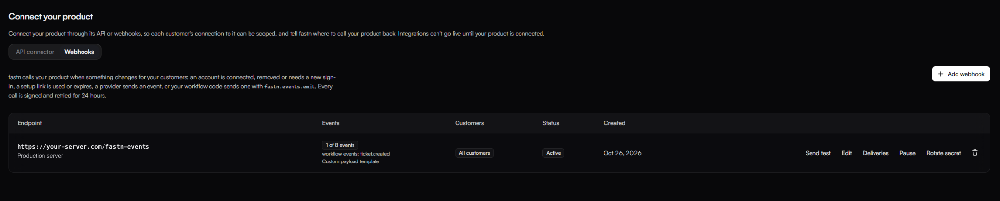
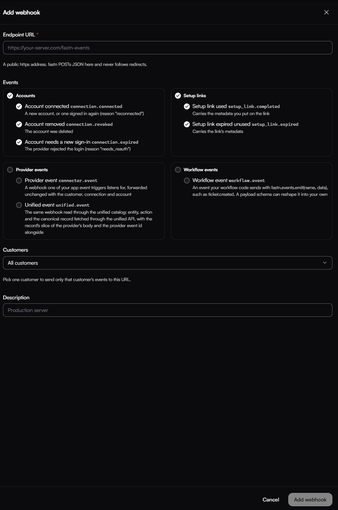
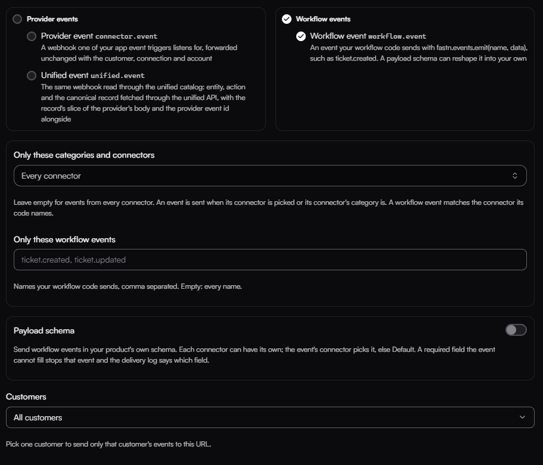
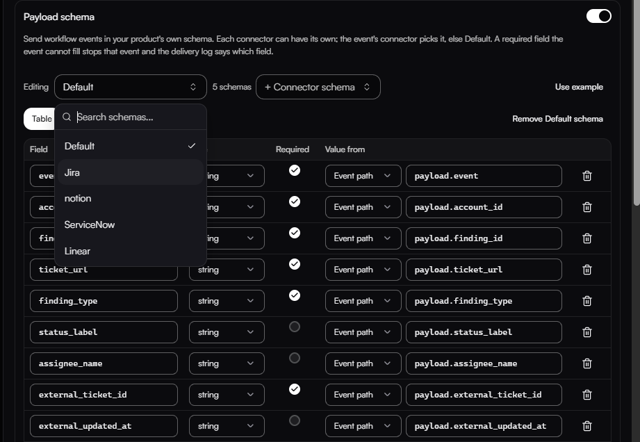

# SaaS Webhooks

The [SaaS connector](saas-connectors.md) you registered lets fastn call your product's API, using each tenant's connection for the right connection scope. Webhooks cover the other direction: they let fastn call your product back when something happens for one of your tenants.

Both live under **Connect your product**: the **API connector** tab is your SaaS connector, and the **Webhooks** tab is described on this page.

### What is the feature?

A webhook is a URL on your server. You give fastn the URL and pick the events you want, and fastn sends a POST request with a JSON body to that URL every time one of those events happens for a tenant.

You can receive:

* **Account events**: a tenant connects an app, removes it, or needs to sign in again.
* **Setup link events**: a setup link is used or expires unused.
* **Provider events**: an event from an app a tenant connected, such as Jira or Linear, passed on unchanged.
* **Unified events**: the same app event in fastn's standard format.
* **Workflow events**: an event your own workflow sends. For example, after your workflow creates a ticket in Jira, Linear or ServiceNow for a tenant, it can send the ticket details to your URL.

Each event carries the tenant it belongs to, so your server knows which of your customers it is about.

### How does it work?

1. Something happens: an account is connected, an app sends an event, or your workflow sends one.
2. fastn checks which of your webhooks want that event and that tenant, and reads each webhook's URL and payload schema.
3. fastn builds the request body. If the event is a workflow event and the webhook has a payload schema, the body is shaped to match it. Otherwise, fastn sends its standard format.
4. fastn sends a POST to your URL with the JSON body.

Every request is signed so your server can check it came from fastn. Each request has these headers:

* `X-Fastn-Event-Id`: a unique id for the event.
* `X-Fastn-Timestamp`: when the request was sent.
* `X-Fastn-Signature`: `sha256=` followed by an HMAC-SHA256 of `<timestamp>.<body>`, made with your webhook's signing secret.

To check a request, compute the HMAC over the raw request body, before you parse the JSON, and compare it in constant time. Reject a timestamp more than 5 minutes from your server's clock, so an old request can't be replayed.

```python
import hmac, hashlib, time

def verify(secret: str, headers, raw_body: bytes) -> bool:
    ts = headers["X-Fastn-Timestamp"]
    if abs(time.time() - int(ts)) > 300:
        return False
    want = "sha256=" + hmac.new(secret.encode(), f"{ts}.".encode() + raw_body, hashlib.sha256).hexdigest()
    return hmac.compare_digest(want, headers["X-Fastn-Signature"])
```

If your server does not answer with a 2xx status within 10 seconds, fastn retries with growing gaps for up to 24 hours. Answer quickly and do slow work after you reply. The event id stays the same on every retry, so if you get the same id twice, ignore the second one.

### How can I add a webhook URL?

You need the Owner, Admin or Developer role.

1. In the fastn dashboard, open **Connect your product** and go to the **Webhooks** tab.

<figure><figcaption>The Webhooks tab lists your webhooks. Click <strong>Add webhook</strong> to create one.</figcaption></figure>

2. Click **Add webhook**.
3. Enter your **Endpoint URL**. It must be a public https address. fastn does not follow redirects.
4. Under **Events**, tick the events you want. All account and setup link events start ticked; untick any you don't need.
5. Under **Customers**, keep **All customers**, or pick one tenant to send only that tenant's events to this URL.
6. Optionally add a **Description**, such as "Production server".
7. Click **Add webhook**.

<figure><figcaption>The <strong>Add webhook</strong> form.</figcaption></figure>

8. Copy the signing secret that is shown. It is shown only once. Store it on your server and use it to check the `X-Fastn-Signature` header.

When you tick **Workflow events**, two more options appear:

* **Only these categories and connectors**: leave it on **Every connector** unless you want to limit which events are sent.
* **Only these workflow events**: the event names to send, comma separated (for example `ticket.created`). Leave it empty to send every name.

<figure><figcaption>Workflow event options and the <strong>Payload schema</strong> switch.</figcaption></figure>

From the webhook's row in the list you can:

* **Send test**: send a test event to the URL.
* **Edit**: change the URL, events or payload schema. The customer is set when the webhook is created and can't be changed.
* **Deliveries**: see recent deliveries and their status, and replay a failed one.
* **Pause**: stop sending for now. Events that happen while it is paused are not sent and don't appear in **Deliveries**. Deliveries already waiting to retry go out when you turn it back on; any still undelivered 24 hours after the event are marked failed, and you can replay them from **Deliveries**.
* **Rotate secret**: get a new signing secret. The old secret stops working at once, so update your server straight away. Deliveries still waiting to retry are signed with the new secret.

### How can I add schemas for different connectors?

A payload schema sets the exact JSON your server receives for workflow events. You list the fields you want, and for each one say where its value comes from in the event.

**Why you would need it:** different apps describe the same thing in different ways. A Jira issue has a key like `FIS-12`, a ServiceNow record has a number like `INC0010020`, and Linear uses an identifier like `ACM-12`. If your system expects a different body for Jira tickets than for ServiceNow records, give each connector its own schema. Your server then gets the shape it expects without translating each one.

To add one:

1. Open the webhook with **Edit** (or use the **Add webhook** form) and turn on **Payload schema**.
2. Click **+ Connector schema** and pick the connector, for example Jira.
3. Use the **Editing** dropdown to choose which schema you are working on.
4. Add each field with **Add field**: its name, its type, whether it is required, and **Value from**. With **Event path**, write where the value is in the event, for example `payload.ticket_url`. Paths starting with `payload.` read the data your workflow sent; `event`, `connector` and `tenantRef` read the event's own fields.

<figure><figcaption>A schema in the Table view. Each field reads its value from the event.</figcaption></figure>

5. Check the result in the preview box under the table, then click **Save**.

You can also edit the schema as JSON in the **JSON Schema** tab, or start from **Use example**. If a field is marked **Required** and the event cannot fill it, that event is not sent, and the delivery log shows which field was missing. It is retried on the normal schedule for up to 24 hours, so if you fix the schema in that time, the waiting events go out. To send one straight away after a fix, use **Resend** in **Deliveries**.

An event uses the schema for the connector (or app) it names. If that has no schema, it uses the **Default** schema. If there is no Default schema either, it gets fastn's standard format.

### What if I want a single schema for all?

Add only a **Default** schema (click **+ Default**) and leave out the connector schemas. Every workflow event sent to that webhook will use it.

Example Default schema in the **JSON Schema** tab:

```json
{
  "type": "object",
  "required": ["event", "finding_id", "ticket_url"],
  "properties": {
    "event":      { "type": "string", "x-source": "event" },
    "finding_id": { "type": "string", "x-source": "payload.finding_id" },
    "ticket_url": { "type": "string", "x-source": "payload.ticket_url" }
  }
}
```

If you turn **Payload schema** off, fastn sends its standard format for each event type.

### Can an AI agent set this up for me?

Yes. If you have connected fastn to an AI agent, such as Claude, Cursor or another tool that uses fastn's MCP server, you can ask it to do any of the steps above in plain language. For example:

* "Add a webhook for `https://example.com/fastn-events` that sends workflow events for all tenants."
* "Add a payload schema to that webhook with these fields: event, finding_id, ticket_url."
* "Give Jira its own schema where ticket_key comes from payload.issue_key."
* "Send a test event and show me the last 5 deliveries."
* "Pause the webhook" or "Rotate the signing secret."

The agent makes the same changes you would make in the dashboard, and they show up there right away. The signing secret is shown only once, so ask the agent for it right after it creates the webhook.
