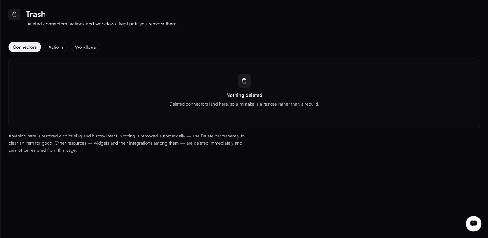

# Trash

**Settings → Trash**

<figure><figcaption>The paragraph underneath warns that widgets are deleted immediately and cannot be restored here.</figcaption></figure>

> Deleted connectors, actions and workflows, kept until you remove them.

Three tabs: **Connectors** (the default), **Actions** and **Workflows**. The Workflows tab lists:

| Column                  | Notes                                        |
| ----------------------- | ---------------------------------------------- |
| **Name**                | The workflow's display name.                  |
| **Slug**                | Restored unchanged. See below.               |
| **Deleted**             | When it was moved here.                       |
| **In trash**            | How long it has been sitting here.            |

Each row ends in **Restore** and a trash icon that deletes it permanently. The other two tabs add one column each: **Connectors** adds **Deleted by** (who deleted it, read from the audit log, or a dash when there is no entry), and **Actions** adds **Connector**.

An action that belongs to a shared catalog connector cannot be restored by you. Once a restore attempt is refused, its button reads **Cannot restore**, with the reason on hover.

### What restore gives you back

Anything here is restored with its slug and history intact. That matters: a workflow that referenced a connector by slug keeps working after a restore, which would not be true if you rebuilt it from scratch.

### Nothing expires

Nothing is removed automatically. Items stay until you clear one for good with the trash icon on its row, which asks you to confirm with **Delete permanently**.


**Delete permanently** cannot be undone. There is no second trash.


### What does not come here

> Other resources (widgets and their integrations among them) are deleted immediately and cannot be restored from this page.

So the recoverable set is exactly connectors, connector actions and workflows. Anything else (a widget and the integrations configured on it, explicitly) goes when you delete it.

### In the audit log

Soft deletes, restores and permanent deletes are recorded separately from one another, which is what lets you reconstruct what happened to something after the fact. Filter by the resource on the [audit log](audit-log.md), and use its **All actions** dropdown for the exact action names your organization emits.
