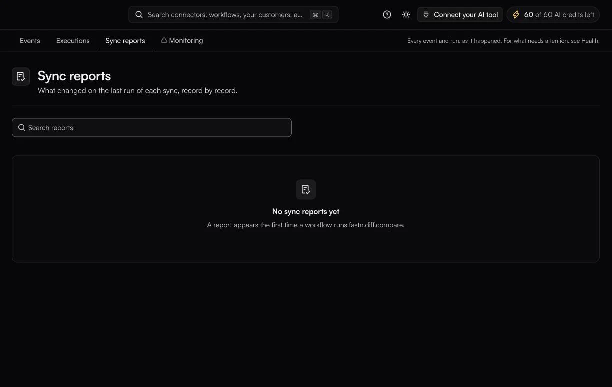

# Sync reports

**Operate → Logs → Sync reports** · `/activity/sync-reports`

Executions tell you a run succeeded. Sync reports tell you what it did, record by record.

<figure><figcaption>A report appears the first time a workflow calls <code>fastn.diff.compare</code>.</figcaption></figure>

### How a report is produced

> A report appears the first time a workflow runs `fastn.diff.compare`.

Reports are opt-in at the workflow level: a workflow that compares its source and target through `fastn.diff.compare` produces one, and a workflow that does not, does not.

### What it is for

A run can succeed and still skip records. When a customer says records are missing, this page distinguishes *the record was filtered out* from *the record was never seen*, which the executions log cannot tell you.

Each workflow also has a **Sync reports** tab in its editor, scoped to that workflow, with the same empty-state note.

### Controls

**Search reports**, plus an **All scopes** select and an **All entities** select. Unlike Events and Executions, this page has no status filters and no date range.

Each report shows its counts of records **unchanged**, **updated**, **created** and **deleted**. Expand a report for two tabs: **Stats**, with the same counts, and **Changes (n)**, the changed records.

Until a workflow has run `fastn.diff.compare`, the page reads **No sync reports yet**.


If you are building a data sync and this page stays empty, ask the fastn agent (or your AI tool) to add diff reporting with `fastn.diff.compare`. It is far easier than reconstructing what a run did from logs afterward.

