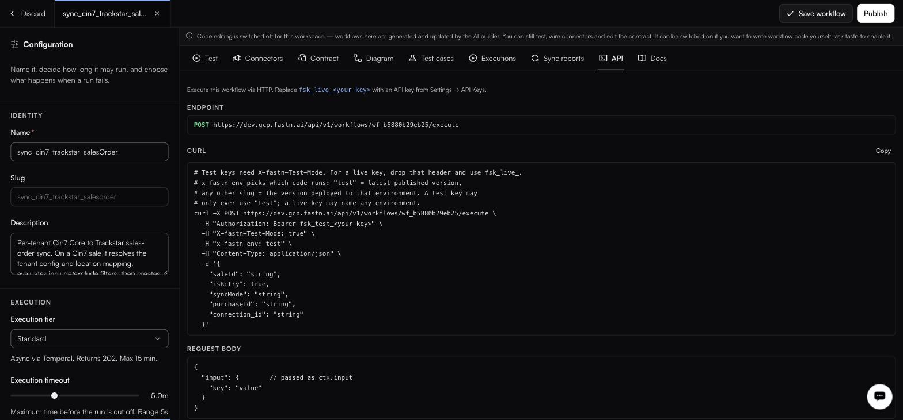

# HTTP API

<figure><figcaption>Every workflow's API tab shows its own endpoint and a copyable curl.</figcaption></figure>

### Base URL

Production base URL: `https://api.fastn.dev`. Your workflow's **API** tab shows the URL for your workspace. Examples below use `YOUR_FASTN_HOST`.

From Node.js or TypeScript, the [SDK](sdk/README.md) (`@fastn-ai/sdk`) wraps the same API in typed methods.

---

## Authentication

Every request carries an API key, as a bearer token or in `X-API-Key`:

```
Authorization: Bearer fsk_live_<your-key>
```

```
X-API-Key: fsk_live_<your-key>
```

These two are the only headers this API reads a key from. A webhook URL is different: it reads `X-API-Key` or `x-fastn-access-key`, and not `Authorization` (see [Webhook endpoints](#webhook-endpoints)). `X-API-Key` is the one header that works on both. No endpoint reads `x-fastn-api-key`: a call that sends the key there is answered `401`.

Keys are created under [Settings → API keys](../manage/api-keys.md) and come in two modes.

| Header                   | Live key                    | Test key                              |
| ------------------------ | --------------------------- | ------------------------------------- |
| `Authorization`          | `Bearer fsk_live_…`         | `Bearer fsk_test_…`                   |
| `X-fastn-Test-Mode`      | Not needed                  | Must be `true`: **a test key is refused without it** |
| `x-fastn-env`            | Any environment slug        | Any environment slug                  |

The rule that is enforced is the test-key one: a test key without `X-fastn-Test-Mode: true` is rejected. Do not read that backwards into an assumption about what a live key may or may not send.

`x-fastn-env` picks which code runs:

* `test`: the workflow's latest published version.
* any other slug: the version deployed to that environment.


A test key is not a sandbox. It reaches the same live connections as a live key and causes the same real writes.


---

## Execute a workflow

```
POST /api/v1/workflows/{workflowId}/execute
```

The workflow id is shown on the workflow's API tab, in the form `wf_b5880b29eb25`.

```bash
curl -X POST https://YOUR_FASTN_HOST/api/v1/workflows/WORKFLOW_ID/execute \
  -H "Authorization: Bearer fsk_test_<your-key>" \
  -H "X-fastn-Test-Mode: true" \
  -H "x-fastn-env: test" \
  -H "Content-Type: application/json" \
  -d '{
    "input": {
      "saleId": "S-1024",
      "isRetry": false,
      "syncMode": "incremental"
    }
  }'
```

### Request body

```json
{
  "input": {
    "key": "value"
  }
}
```

The `input` object is what arrives as `ctx.input`. Its shape comes from the workflow's input contract.


Every workflow's **API** tab generates a ready-to-run curl filled in with that workflow's own host, id and contract fields. When the two differ, copy from there. It is generated from the deployment you are actually calling.


### Response: Instant tier

The workflow's return value comes back inline, synchronously, within the tier's 30-second ceiling. Its shape is the workflow's own **output contract**: read it on the Contract tab rather than from an example here, because it is different for every workflow.

### Response: Standard and Long tiers

`202 Accepted` with an execution id, in the form `exec_…`. The run continues in the background; the id is what identifies it afterwards in [Executions](../operate/executions.md), where each row expands to its input, output and per-step timings.


There is no documented endpoint for polling an execution id. If your caller needs to know the outcome of a Standard or Long run, have the workflow call you back at the end rather than assuming you can poll for it.


---

## Scoping a call to a customer

fastn is multi-tenant: the same workflow serves all of your customers, and headers on the request are what say which one a call is for.

| Header                          | Carries                                                       |
| ------------------------------- | --------------------------------------------------------------- |
| `x-end-org-id`                  | The customer this call acts for.                               |
| `x-end-org-ref`                 | Your own reference for that customer.                          |
| `x-installation-id`             | Which installation of the integration the call belongs to.     |
| `x-fastn-connections`           | The connections the run may use.                               |
| `x-fastn-installation-config`   | The configuration values that installation was set up with.    |

Inside the workflow these arrive on `ctx.headers`. See [Workflow runtime API](workflow-runtime.md). Exact value formats are on each workflow's own **Docs** tab, generated from the deployment you are calling; check there before you hard-code one.

---

## Unified endpoints

Where a [unified API](../build/unified-apis/README.md) covers an entity, call it directly rather than a specific connector.

```http
GET  /api/v1/unified/crm/account?page_size=50
GET  /api/v1/unified/crm/account/{recordId}
POST /api/v1/unified/crm/account
POST /api/v1/unified/crm/note
```

fastn routes to whichever provider the customer authorised. Each endpoint on the Unified APIs page has a **Copy curl** button with the correct headers filled in.

---

## Webhook endpoints

A [webhook trigger](../build/triggers/README.md) gives you a public URL. Whether callers must authenticate is set on the trigger:

| Authentication setting            | Caller must send                      |
| --------------------------------- | --------------------------------------- |
| **API Key (x-api-key)**           | `X-API-Key: fsk_…` or `x-fastn-access-key: fsk_…` |
| **None (public)**                 | Nothing                               |

A webhook URL does not read `Authorization`, so a bearer token there is answered `401`. `X-API-Key` counts only when its value starts `fsk_`, the prefix every fastn key has, so a sender's own `x-api-key` is not mistaken for one.

---

## Embed tokens

Tokens that scope the widget to one customer. Mint them from your backend with your API key; never expose the API key to a browser.

### Mint a token

```
POST /api/v1/embed/token
```

| Header            | Value                    |
| ----------------- | ------------------------ |
| `Authorization`   | `Bearer <API key>` (or `X-API-Key: <API key>`) |
| `x-org-id`        | The customer: your id for them, or fastn's |
| `x-user-id`       | Optional. Your id for the user |
| `x-identity-hmac` | Hex HMAC-SHA256 of `<x-org-id>\n<x-user-id>`, signed with the key's identity secret. Required when the key's **Verify caller identity** is set to Enforce |

With these headers the body can be empty. A key without identity verification can name the customer in the body instead: `{"endOrgId": "…", "userId": "…"}`. Where the API key is limited to a single customer, send `{"endOrgId": "…"}` in the request body instead of the `x-org-id` header, set to fastn's own id for the customer: with such a key the external id is `404 Tenant not found`, and `x-org-id` is `400 IDENTITY_HEADERS_CONFLICT`.

```json
{
  "data": {
    "token": "emb_…",
    "endOrgId": "…",
    "userId": "…",
    "role": "end_user",
    "tierId": null,
    "expiresAt": "…",
    "expiresIn": 28800
  }
}
```

The token is `data.token`. `expiresIn` is **28800 seconds: eight hours**. `endOrgId` is fastn's id for the customer the token is scoped to, and the returned role is always `end_user`.

Every body field and error: [Generating embed tokens](../tutorials/developer/generating-embed-tokens.md).

### Refresh

```
POST /api/v1/embed/token/refresh
```

The body is `{"token": "emb_…"}`, and no API key is sent: the token is the credential. The answer is `data.token`, `data.endOrgId`, `data.role`, `data.expiresAt` and `data.expiresIn`, with no `userId` or `tierId`. `expiresIn` is the seconds the new token has left, below 28800 near the seven-day cap.


**Refresh is capped at seven days per session.** At the cap the widget posts `fastn:session-expired` to the parent window and stops: refreshing again does not extend it. Listen for that message and start a new session by minting a fresh token. A host app that assumes refresh is indefinite will strand long-lived sessions.


### Using the token

The iframe endpoint takes it on the query string:

```
https://YOUR_FASTN_HOST/api/v1/embed/iframe?token=emb_…
```

That URL carries a live credential. Treat it like one: build it server-side per session, and do not log or share it. Full setup in [Embedding the widget](../embed/embedding/README.md).

---

## Errors

| Response                  | Means                                                                          |
| ------------------------- | -------------------------------------------------------------------------------- |
| `WORKFLOW_NOT_PUBLISHED`  | The workflow has never had a snapshot published, so there is no version to run. **Every call returns this until you publish one**. It is the most common cause of "the API did nothing". Publish from the workflow editor. |
| `401` / `403`             | The key is wrong, revoked, expired, outside its IP allowlist, or lacks the permission for what you called. Check the key on [Settings → API keys](../manage/api-keys.md). |
| Test key rejected         | The key is a test key and `X-fastn-Test-Mode: true` was not sent.                |

A workflow that runs and throws is a **Failed** execution rather than a transport error: look for it in [Executions](../operate/executions.md), not in the HTTP response.

---

## Rate limits

Per-day and per-minute ceilings on API calls and events are listed, with current usage, on [Settings → Billing](../manage/billing.md), which also carries per-customer limits. Going over stops new work rather than charging you, and nothing already running is interrupted, so a caller that suddenly gets nowhere is worth checking against that page before you debug the workflow.
