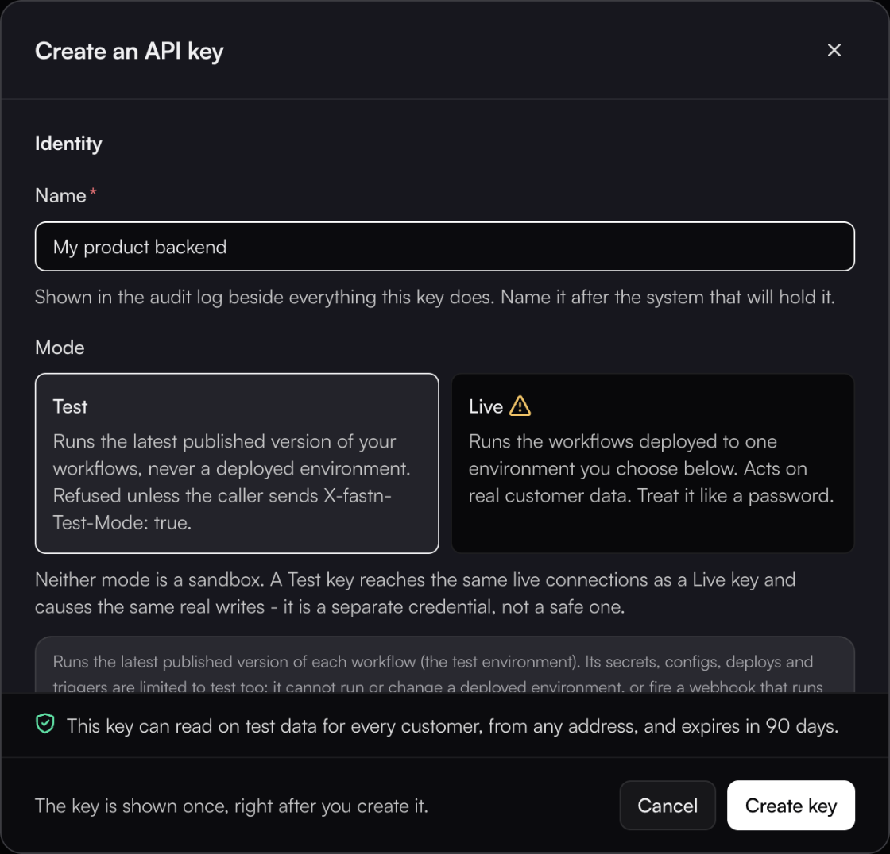
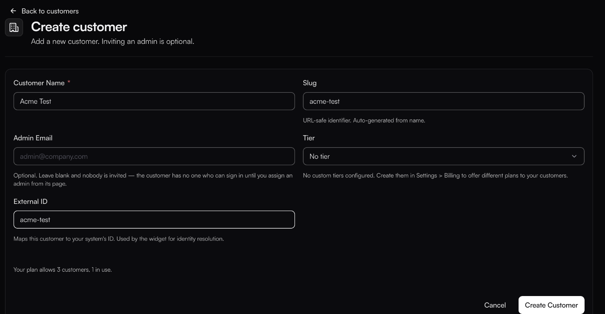
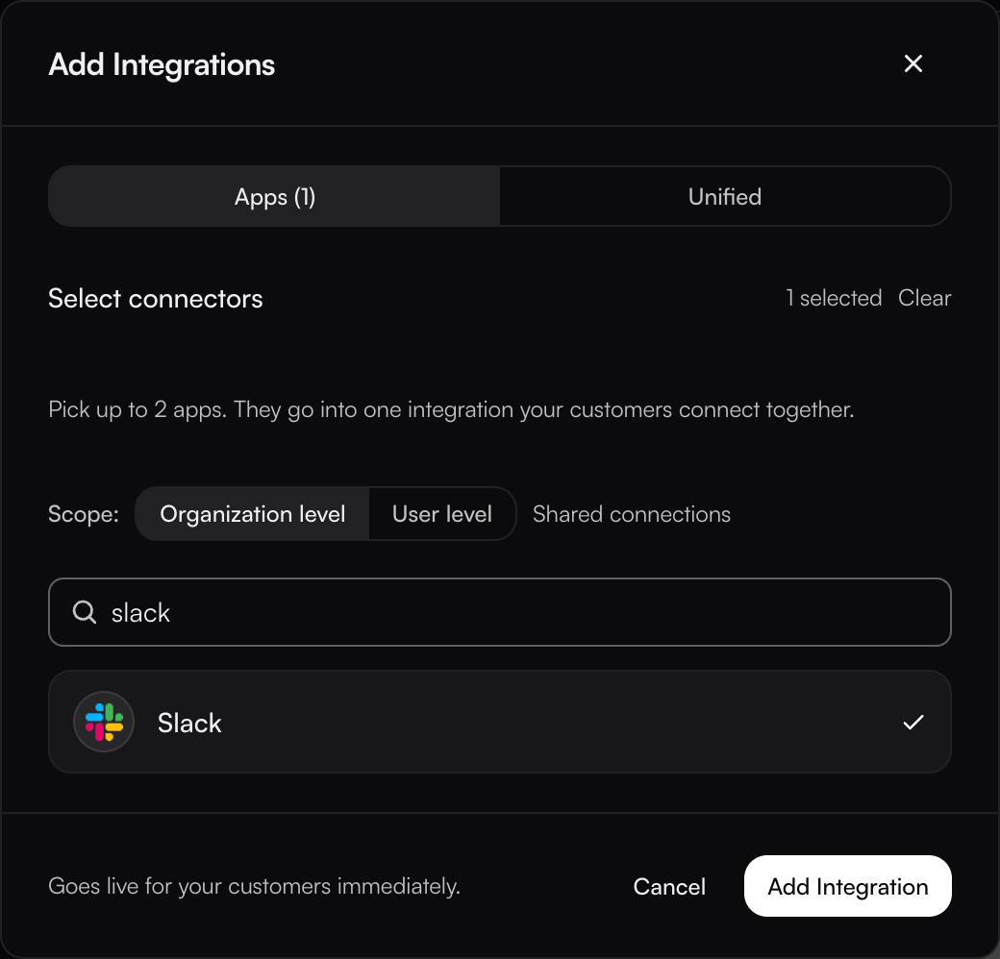
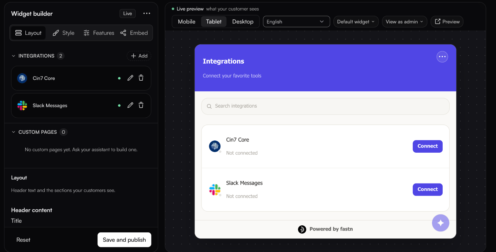
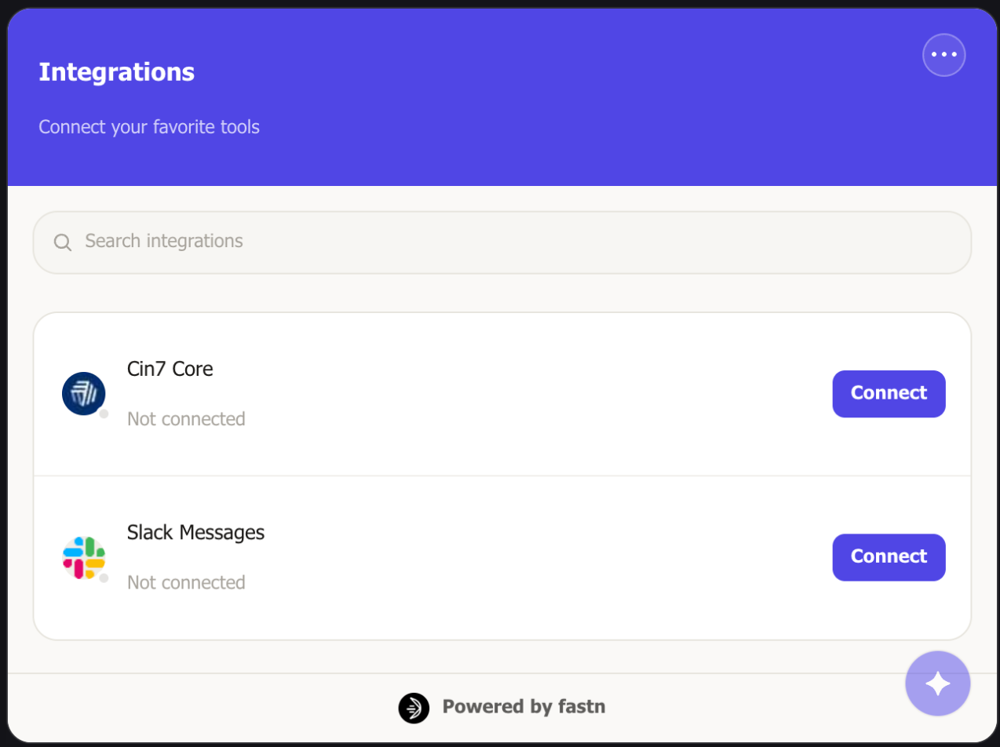

# Embedding quickstart

### Overview

In this quickstart, you put the Fastn widget in a page of your product, then connect an app through it as a customer would. It takes about ten minutes, and you can do all of it from a new Fastn account.

You will:

1. [Set up Fastn](#part-1-set-up-fastn): create an API key, a test customer and a widget.
2. [Embed the widget](#part-2-embed-the-widget): get a token on your backend, show the widget on your page, and connect an app.

This quickstart is for developers. It assumes you know how to add an HTTP endpoint to your backend and run JavaScript on your frontend.

<figure><figcaption><p>Your API key stays on your backend. Only the short-lived token reaches the browser.</p></figcaption></figure>

The finished code is in the [embed-node](https://github.com/fastn-ai/docs/tree/main/examples/embed-node) example. For a Python backend, see [token-server-python](https://github.com/fastn-ai/docs/tree/main/examples/token-server-python).

### Before you start

* **A Fastn account with the Owner or Admin role.** You need it to create an API key. Sign up at [app.fastn.dev](https://app.fastn.dev/?signup=1).
* **A backend that can keep a secret,** such as a Node.js 18+ server with Express. The code below uses Express.
* **An account in one app,** such as Slack or HubSpot, to connect in the last step.

### Part 1: Set up Fastn

In this part, you create the three things the widget needs: an API key for your backend, a customer to show the widget to, and a widget with one integration in it.

#### Step 1.1: Create an API key

Your backend uses the API key to ask Fastn for a widget token.

1. Go to **Embed → API keys** ([Open in Fastn](https://app.fastn.dev/api-keys)) and click **Create key**.
2. Give the key a name, and leave the other settings as they are. A new key is a **Test** key.
3. Click **Create key**, and copy the key. It's shown only once.

<figure><figcaption>The <strong>Create an API key</strong> dialog. <strong>Test</strong> is selected by default.</figcaption></figure>

**You should see:** a key that starts with `fsk_test_`.

#### Step 1.2: Create a test customer

The widget always runs for one customer, so you need one to test with.

1. Go to **Operate → Customers** ([Open in Fastn](https://app.fastn.dev/customers)) and click **Create customer**.
2. Enter a name, and an **External ID** such as `acme-test`.
3. Click **Create Customer**.

<figure><figcaption>The <strong>Create customer</strong> form, with an example name and External ID.</figcaption></figure>

**You should see:** the new customer in the list. Note its External ID.

#### Step 1.3: Add an integration to your widget

The widget shows your customers the integrations you add to it.

1. Go to **Embed → Widget** ([Open in Fastn](https://app.fastn.dev/widgets)).
2. Next to **INTEGRATIONS**, click **+ Add**.
3. Search for the app you'll connect, such as Slack, and select it.
4. Click **Add Integration**. The integration goes live for your customers right away.

<figure><figcaption>Pick the app in <strong>Add Integrations</strong>.</figcaption></figure>

**You should see:** the integration listed under **INTEGRATIONS**, and in the live preview.

<figure><figcaption>The widget builder, with the live preview of what your customers see.</figcaption></figure>

For more options, see [Build your widget](../saas-admin/building-your-widget.md).

### Part 2: Embed the widget

In this part, your backend gets a short-lived token from Fastn, and your frontend uses it to show the widget.

#### Step 2.1: Get a token with curl

Check that your key works before you write code. Replace `<your-key>` with your API key, and `<your-customer-id>` with the External ID from step 1.2:

```bash
curl -X POST https://api.fastn.dev/api/v1/embed/token \
  -H "Authorization: Bearer fsk_test_<your-key>" \
  -H "X-fastn-Test-Mode: true" \
  -H "x-org-id: <your-customer-id>" \
  -H "Content-Type: application/json" \
  -d '{"userId": "test-user"}'
```

**You should see:** a JSON response with the token at `data.token`, starting with `emb_`.

#### Step 2.2: Get a token from your backend

Add a function to your backend that does the same request. Keep the API key in an environment variable, never in frontend code.

```javascript
// Server-side only. Uses the fetch built into Node.js 18+.
async function getFastnToken({ customerId, userId, userEmail, userName }) {
  const res = await fetch("https://api.fastn.dev/api/v1/embed/token", {
    method: "POST",
    headers: {
      "Authorization": `Bearer ${process.env.FASTN_API_KEY}`,
      "Content-Type": "application/json",
      "X-fastn-Test-Mode": "true", // needed for fsk_test_ keys only
      "x-org-id": customerId,      // the customer's External ID or Fastn ID
    },
    body: JSON.stringify({ userId, userEmail, userName }), // the signed-in person
  });

  const json = await res.json();
  return json.data.token; // the token is under `data`
}
```

**You should see:** the function returns a token that starts with `emb_`.

#### Step 2.3: Send the token to your frontend

Add an endpoint that your frontend calls to get a fresh token. Return only the token, never the API key.

```javascript
// Express route. req.user is your signed-in user.
app.get("/api/fastn-token", async (req, res) => {
  const token = await getFastnToken({
    customerId: req.user.companyId, // however your app knows the customer
    userId: req.user.id,
    userEmail: req.user.email,
    userName: req.user.name,
  });
  res.json({ token });
});
```

**You should see:** a request to `/api/fastn-token` returns `{ "token": "emb_..." }`.

#### Step 2.4: Show the widget on your page

On your frontend, get a token and load the widget in an iframe. Your page needs an element with the id `integrations` to hold it.

```javascript
// Get a fresh token each time the page loads.
const { token } = await fetch("/api/fastn-token").then((r) => r.json());

// The token names the customer and user, so the URL needs nothing else.
const iframe = document.createElement("iframe");
iframe.src = `https://api.fastn.dev/api/v1/embed/iframe?token=${token}`;
iframe.style.width = "100%";
iframe.style.height = "100%";
iframe.style.border = "none";
document.getElementById("integrations").appendChild(iframe);
```

**You should see:** the Fastn widget in your page, listing your integration with a **Connect** button.

<figure><figcaption>The widget as your customers see it.</figcaption></figure>

#### Step 2.5: Connect an app

1. In the widget, click **Connect** on your integration.
2. Sign in to the app in the window that opens, and approve access.

**You should see:** the app marked as **Connected**.

You now have the widget running in your product, for one customer, with a working connection.

### Next steps

* [Generate embed tokens](generating-embed-tokens.md): sign each token request, so a caller can't act as another customer.
* [Deployment checklist](deployment.md): switch to a live key and prepare for production.
* [Troubleshooting](troubleshooting.md): fix a blank widget or a failed connection.
