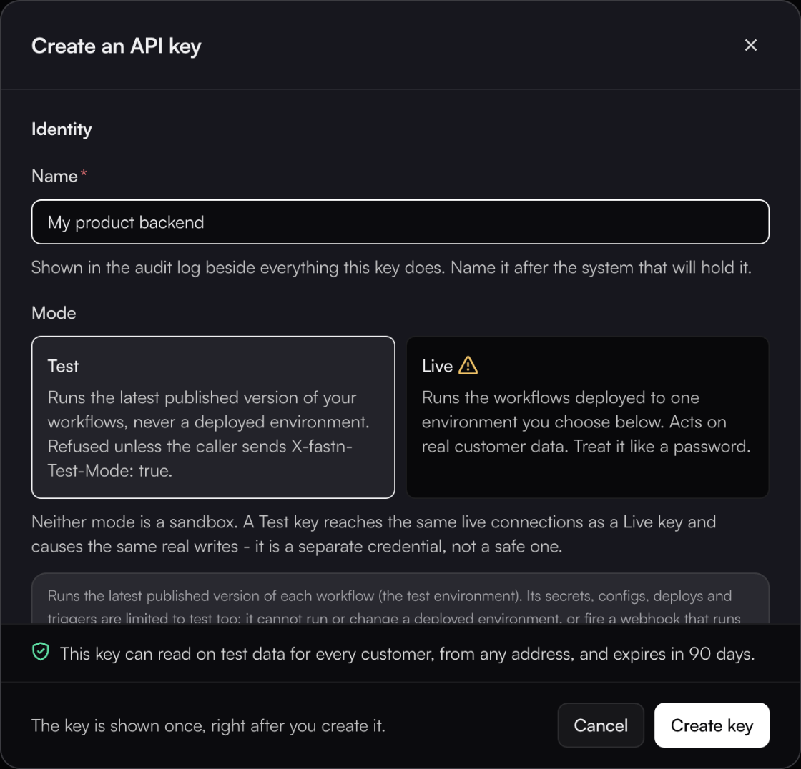

# Set up authentication

At the end of this guide, your backend has an API key and makes authenticated calls to Fastn, first with a Test key, then with a Live key.

### Before you start

* **The Owner or Admin role** in your Fastn account, to create an API key.
* **A customer with an External ID,** such as `acme-test`. To create one, go to **Operate → Customers** ([Open in Fastn](https://app.fastn.dev/customers)) and click **Create customer**.
* **A terminal with `curl`,** to check your key.

To learn what each credential does first, see [How authentication works](how-authentication-works.md).

### Step 1: Create a Test key

1. Go to **Embed → API keys** ([Open in Fastn](https://app.fastn.dev/api-keys)) and click **Create key**.
2. In **Name**, name the key after the service that will hold it, such as `My product backend`.
3. Leave **Mode** on **Test**.
4. In **Permissions**, select **Embed backend**.
5. In **Customers it can reach**, leave **Every customer** selected.
6. Click **Create key**, and copy the key. It's shown only once.
7. Store the key in an environment variable on your backend, such as `FASTN_API_KEY`. Never put it in frontend code or commit it to source control.

<figure><figcaption>The <strong>Create an API key</strong> dialog. <strong>Test</strong> is selected by default.</figcaption></figure>

**You should see:** a key that starts with `fsk_test_`.

For every option in the dialog, see [API keys](../../manage/api-keys.md).

### Step 2: Make an authenticated request

Ask Fastn for an embed token for your customer. Replace `<your-customer-id>` with the customer's External ID:

```bash
curl -X POST https://api.fastn.dev/api/v1/embed/token \
  -H "Authorization: Bearer $FASTN_API_KEY" \
  -H "X-fastn-Test-Mode: true" \
  -H "x-org-id: <your-customer-id>" \
  -H "Content-Type: application/json" \
  -d '{"userId": "test-user"}'
```

* `Authorization` carries your API key.
* `X-fastn-Test-Mode: true` is required with a Test key.
* `x-org-id` names the customer the call acts for.

**You should see:** a JSON response with a token at `data.token` that starts with `emb_`.

If you get `403` with `Test API keys require X-fastn-Test-Mode: true header`, add the `X-fastn-Test-Mode` header.

### Step 3: Switch to a Live key

When your workflows are deployed and you're ready for production, create a Live key.

1. Go to **Embed → API keys** ([Open in Fastn](https://app.fastn.dev/api-keys)) and click **Create key**.
2. Name the key, and select **Live** in **Mode**.
3. In **Environment**, select the environment your workflows are deployed to, such as **Live**. The key can run only that environment, and the latest published version.
4. Select **Embed backend** in **Permissions**, and leave **Every customer** selected.
5. Click **Create key**, and copy the key.
6. In your production environment, set `FASTN_API_KEY` to the new key, and remove the `X-fastn-Test-Mode` header from your requests.

**You should see:** the request from step 2, without `X-fastn-Test-Mode`, returns a token that starts with `emb_`.

Before you go live, also set an expiry, and consider [verifying caller identity](../../manage/identity-verification.md) so a call can't claim to be another customer. See the [Deployment checklist](deployment.md).

### What's next

* [Embedding quickstart](embedding-quickstart.md): use the token to show the widget in your product.
* [Generate embed tokens](generating-embed-tokens.md): refresh tokens, and sign each token request.
* [HTTP API](../../reference/api.md#authentication): the headers each endpoint reads.
